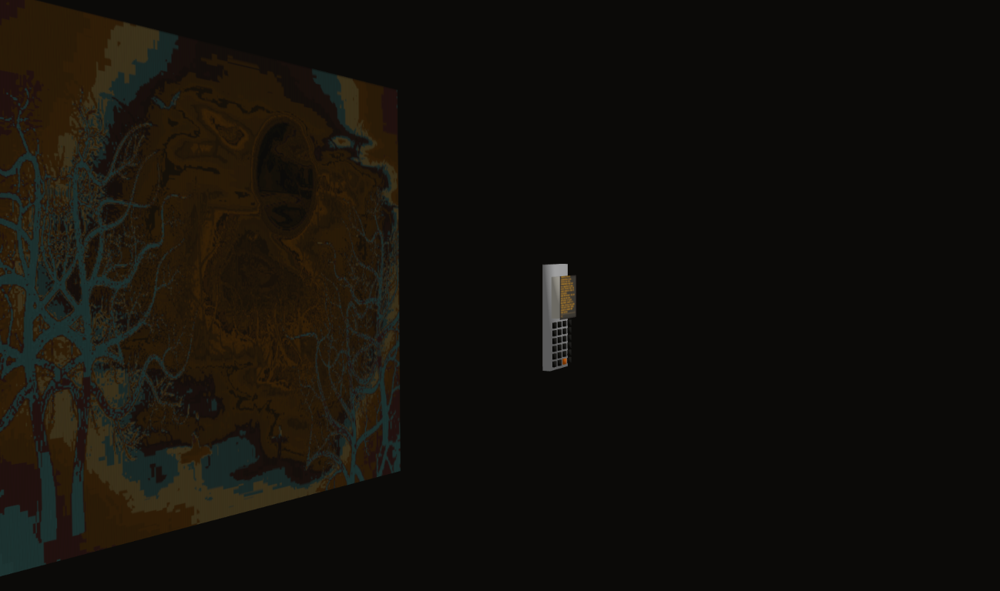
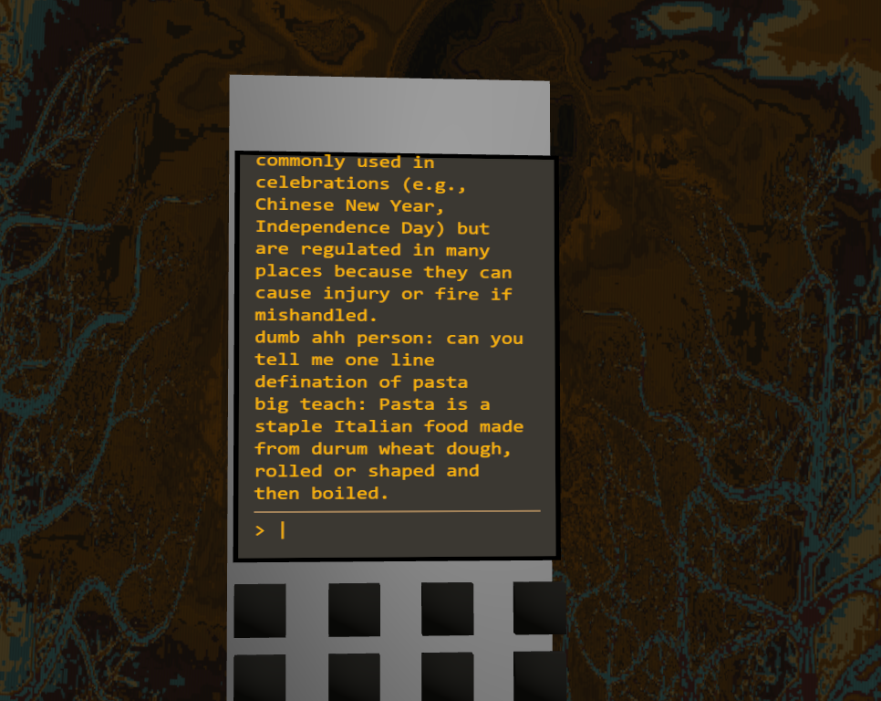
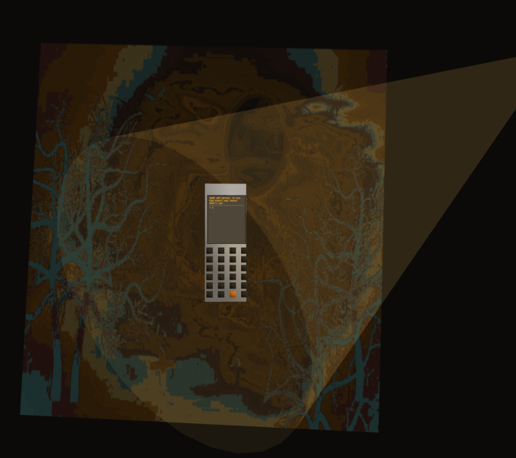
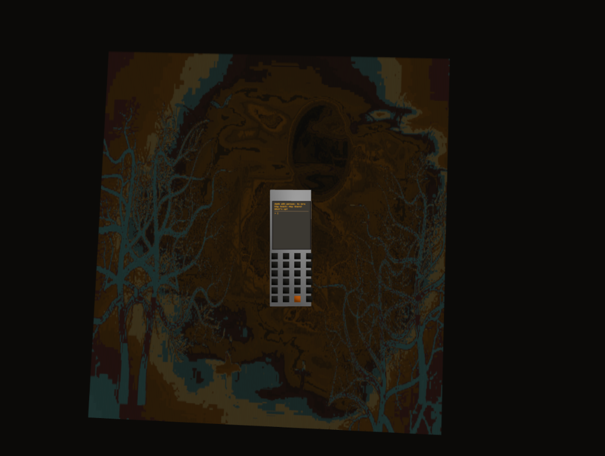

# HorrorAHH AI

Hi, I'm Samarth. This is my Halloween-themed AI calculator and chat assistant, made during the 3amXBobaBash Delhi 

It looks like a strange calculator or feature phone, but its screen can answer questions through Groq. The scene is dark and interactive.

## Live demo

[View the live project](https://horrorahhai-cbtf1v9rt-asamarth875-1981s-projects.vercel.app/)

## Demo

## Features

- 3D horror-themed calculator made with Three.js
- AI chat powered by Groq
- Keyboard and on-screen button interactions
- Flickering colored lights cast an unstable glow across the scene
- The background uses ASCII art that we generated with the help of a tool
- Close camera views, a terminal-style chat screen, and orbit controls
- Separate Node.js API route for chat requests

## Deploy on Vercel

1. Import the GitHub repository into Vercel.
2. Add `GROQ_API_KEY` under Project Settings > Environment Variables.
3. Optionally add `GROQ_MODEL`.
4. Redeploy the project.

## Built with

- HTML and CSS
- JavaScript and Node.js
- [Three.js](https://threejs.org/)
- [Groq](https://groq.com/)

## Credits

ASCII background created with help from [Jassi](https://jascii.jassi.dev/).
